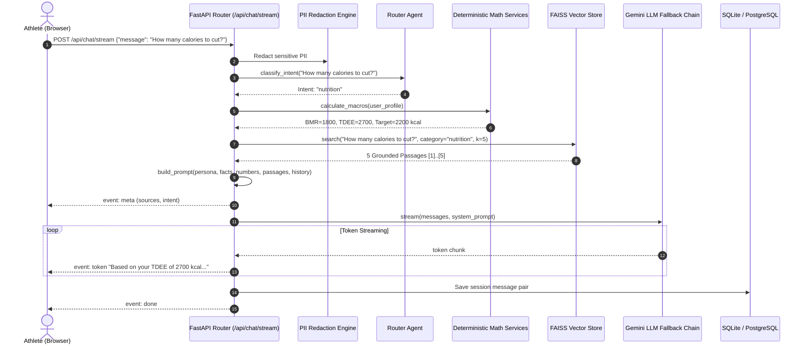

# FitBot RAG Architecture & System Guide
**Module**: RAG Core & Athlete Profile Module  
**Owner & Lead Developer**: Nessim  
**Project**: FitBot — Evidence-Based AI Fitness Coach  
**Last Updated**: October 2026

---

## Table of Contents
1. [Overview & Philosophy](#1-overview--philosophy)
2. [High-Level Architecture](#2-high-level-architecture)
3. [Document Ingestion Pipeline (`ingest.py`)](#3-document-ingestion-pipeline-ingestpy)
   - [Document Corpus & Manifest](#document-corpus--manifest)
   - [Chunking Strategy](#chunking-strategy)
   - [Embedding Generation](#embedding-generation)
   - [FAISS Vector Indexing](#faiss-vector-indexing)
4. [Intelligent Routing Agent (`router_agent.py`)](#4-intelligent-routing-agent-router_agentpy)
   - [Hybrid Intent Classification](#hybrid-intent-classification)
   - [Exercise Entity Extraction & Alias Resolution](#exercise-entity-extraction--alias-resolution)
   - [Context Enrichment & Zero-Hallucination Math Injection](#context-enrichment--zero-hallucination-math-injection)
   - [Natural Language Workout Logging Parser](#natural-language-workout-logging-parser)
5. [Prompt Engineering Architecture (`backend/app/prompts/`)](#5-prompt-engineering-architecture-backendappprompts)
   - [Core Persona & Guardrails](#core-persona--guardrails)
   - [Intent-Specific Templates](#intent-specific-templates)
   - [Somatotype & Athlete Blueprint Prompts](#somatotype--athlete-blueprint-prompts)
6. [LLM Engine & Resilience Layer (`engine.py`)](#6-llm-engine--resilience-layer-enginepy)
   - [LLM Client Abstraction](#llm-client-abstraction)
   - [Gemini Multi-Model Fallback Chain](#gemini-multi-model-fallback-chain)
   - [Graceful Degradation (Offline Mode)](#graceful-degradation-offline-mode)
7. [API Endpoints & Streaming Delivery (`router.py`)](#7-api-endpoints--streaming-delivery-routerpy)
   - [Synchronous Chat vs. Server-Sent Events (SSE)](#synchronous-chat-vs-server-sent-events-sse)
   - [Session Management & History Pruning](#session-management--history-pruning)
   - [Privacy & PII Redaction](#privacy--pii-redaction)
8. [End-to-End Request Lifecycle](#8-end-to-end-request-lifecycle)
9. [Developer Guide & CLI Reference](#9-developer-guide--cli-reference)

---

## 1. Overview & Philosophy

FitBot's **Retrieval-Augmented Generation (RAG)** system is the intelligence engine powering natural language interactions between athletes and FitBot. 

Traditional generative AI chatbots suffer from two fatal flaws in fitness coaching:
1. **Probabilistic Hallucination of Scientific Claims**: Generic LLMs invent unverified training advice, conflicting nutritional theories, or dangerous form recommendations.
2. **Math Incompetence**: Language models cannot reliably perform multi-step arithmetic for metabolic rates (BMR/TDEE), progressive overload weight increments, or macronutrient splits.

### The FitBot Solution: Hybrid Deterministic RAG
FitBot solves this through a hybrid architecture:
- **Deterministic Math Engine**: All caloric formulas (Mifflin-St Jeor, Katch-McArdle), macro allocations, and progressive overload calculations are computed in strict Python code before the LLM is ever called.
- **RAG Grounding**: Factual fitness knowledge is retrieved from authoritative exercise physiology textbooks and nutrition manuals using dense vector search (FAISS).
- **Strict Citation Rules**: The LLM acts purely as an articulate communicator that quotes the exact math and cites retrieved passages `[1], [2]`, with strict instructions never to invent numbers or advice.

---

## 2. High-Level Architecture

```
                                  USER QUERY
                                      │
                                      ▼
                        ┌───────────────────────────┐
                        │    Privacy Filter (PII)   │  (Redacts names, emails, phones)
                        └─────────────┬─────────────┘
                                      │
                                      ▼
                        ┌───────────────────────────┐
                        │  Hybrid Intent Classifier │  (Rules / Heuristics -> Fast LLM fallback)
                        └─────────────┬─────────────┘
                                      │
             ┌────────────────────────┼────────────────────────┐
             ▼                        ▼                        ▼
       [Nutrition]           [Exercise / Form]       [Progressive Overload]
             │                        │                        │
             ▼                        ▼                        ▼
┌────────────────────────┐┌────────────────────────┐┌────────────────────────┐
│ Calculate Exact Macros ││ Extract Exercise Slugs ││ Fetch 1RM & Progression│
│ (BMR, TDEE, Deficit)   ││ (Barbell Bench, Squat) ││ (Double Progression)   │
└────────────┬───────────┘└───────────┬────────────┘└───────────┬────────────┘
             └────────────────────────┼────────────────────────┘
                                      │
                                      ▼
                        ┌───────────────────────────┐
                        │ Dense Retrieval (FAISS)   │  (all-MiniLM-L6-v2, top-k=5, min_score=0.25)
                        └─────────────┬─────────────┘
                                      │
                                      ▼
                        ┌───────────────────────────┐
                        │    Prompt Assembler       │  (Injects Persona + User Facts +
                        │                           │   Calculated Numbers + Passages)
                        └─────────────┬─────────────┘
                                      │
                                      ▼
                        ┌───────────────────────────┐
                        │  Gemini Multi-Model Chain │  (gemini-3.5-flash-lite -> 3.5-flash -> flash-lite)
                        └─────────────┬─────────────┘
                                      │
                         ┌────────────┴────────────┐
                         ▼                         ▼
                  [Token Streaming]       [Degraded Mode]
                  (SSE to Frontend)       (Raw Passages if offline)
```

---

## 3. Document Ingestion Pipeline (`ingest.py`)

The ingestion pipeline converts raw scientific PDFs into dense vector embeddings stored in partitioned FAISS indexes.

### Document Corpus & Manifest
Located in `backend/docs/`, categorized via `manifest.json`:
| Document Name | Domain Category | Key Contents |
| :--- | :--- | :--- |
| `360Nutritionprogram1.pdf` | `nutrition` | Meal scheduling, macro distribution, hydration |
| `NNC_2016_Newsletter_1.pdf` | `nutrition` | Dietary guidelines, sports nutrition science |
| `Printable-Workout-Nutrition-Infographic.pdf` | `nutrition` | Nutrient timing, pre/post-workout fueling |
| `BodyType+Training+and+Nutrition.pdf` | `exercise` | Somatotype-specific adaptation, volume tolerance |
| `Functional-Training-Guide-IAFS.pdf` | `exercise` | Movement patterns, kinetic chains, injury prevention |
| `EndomorphEvolution.pdf` | `exercise` | Resistance programming for slower metabolic rates |
| `Deload_and_Fatigue_Management...pdf` | `exercise` | Fatigue accumulation, MEV/MRV landmarks, deloads |

### Chunking Strategy
- **Target Chunk Size**: `900` characters.
- **Chunk Overlap**: `150` characters.
- **Boundary Preservation**: Text is split first along paragraph breaks (`\n\n`), then sentence boundaries (`[.!?]`), and only falls back to word boundaries for continuous blocks.
- **Scanned Page Guard**: Pages containing fewer than 50 characters trigger a warning so OCR or PDF issues are spotted immediately.
- **Stable Chunk IDs**: Formatted as `{category}_{file_slug}_p{page}_c{chunk_index}` (e.g. `nutrition_360nutrition_p12_c1`).

### Embedding Generation
- **Model**: `sentence-transformers/all-MiniLM-L6-v2`
- **Output Dimensions**: 384 dimensions.
- **Normalization**: All embedding vectors are L2-normalized upon creation so that inner product (`IP`) is mathematically equivalent to **cosine similarity**.
- **Test Embedder**: Includes a deterministic, offline `FakeEmbedder` that produces 384-dim pseudo-vectors from MD5 seeds to allow rapid testing without downloading model weights.

### FAISS Vector Indexing
- **Index Type**: `faiss.IndexFlatIP` (Exact maximum inner product search).
- **Partitioning**: Separate index and metadata files are maintained:
  - `nutrition.faiss` + `nutrition_chunks.json`
  - `exercise.faiss` + `exercise_chunks.json`
- **Benefit of Partitioning**: Minimizes cross-domain noise (e.g. searching for "squat depth" never accidentally retrieves protein smoothie recipes).

---

## 4. Intelligent Routing Agent (`router_agent.py`)

Rather than blindly sending every prompt to the vector database, FitBot uses a specialized agent layer that interprets intent, identifies exercises, and enriches context.

### Hybrid Intent Classification
FitBot classifies user messages into 5 discrete intents:
1. `nutrition`: Diet, calorie targets, protein requirements, cutting/bulking.
2. `exercise_technique`: Form cues, biomechanics, joint setup, injury pain prevention.
3. `workout_logging`: Confirmation of completed sets, weights, and reps.
4. `overload_advice`: Progression stall, plateau breaking, 1RM, deload recommendations.
5. `general`: Fitness philosophy, sleep, recovery, general health.

**Classification Priority**:
1. **Rule-Based Heuristic (Instant, 0ms)**: Fast regex checks for logging patterns (`80kg 3x8`, `3 sets of 10 reps`) and domain keywords.
2. **LLM Fallback**: If no keywords match with high confidence, a lightweight classification prompt evaluates the intent.

### Exercise Entity Extraction & Alias Resolution
FitBot maintains an alias mapping dictionary covering common gym shorthand:
- `"bench"` / `"incline bench"` $\rightarrow$ `barbell-bench-press` / `incline-dumbbell-press`
- `"rdl"` $\rightarrow$ `barbell-romanian-deadlift`
- `"ohp"` $\rightarrow$ `overhead-barbell-press`
- `"bulgarian"` $\rightarrow$ `bulgarian-split-squat-bodyweight`

Aliases are sorted by string length descending to ensure longer specific names (e.g., "incline bench press") match before shorter substrings ("bench").

### Context Enrichment & Zero-Hallucination Math Injection
When an intent is detected, the `enrich()` function executes domain services before retrieval:
```python
# If intent is 'nutrition':
# Computes exact BMR, TDEE, Calorie Deficit/Surplus, and Protein/Carb/Fat grams:
numbers = "BMR: 1740 kcal, TDEE: 2697 kcal, Target Calories: 2427 kcal, Protein: 165.0g, Carbs: 273.0g, Fat: 75.5g"

# If intent is 'overload_advice':
# Queries user's set history and computes exact double-progression targets:
numbers = "barbell-bench-press: Target 82.5 kg for 3x8 (Alternative: 80.0 kg for 3x10). Reason: Hit top of rep target last session."
```
These numbers are injected directly into the LLM system prompt under `CALCULATED NUMBERS (DO NOT RECOMPUTE)`.

### Natural Language Workout Logging Parser
Users can log workouts conversational-style:
> *"Just did bench press 85kg for 8, 8, 7 reps at RPE 8.5"*

The parser extracts:
- `exercise_id`: `barbell-bench-press`
- `sets`: 3 sets with respective weight, reps, and RPE
- Emits a `pending_action: {"action_type": "log_workout", "sets": [...]}` allowing the frontend to show a 1-click **"Confirm & Log Set"** card.

---

## 5. Prompt Engineering Architecture (`backend/app/prompts/`)

All system prompts are centralized and documented in `backend/app/prompts/`:

```
backend/app/prompts/
├── __init__.py       # Master registry and developer ownership directory
├── coach.py          # RAG Persona, Safety Disclaimer, and 5 Intent Templates
├── guidance.py       # Somatotype diagnostic prompts and Athlete Blueprint
├── routine.py        # Routine assistant & volume gap rationale (Montassar)
└── vision.py         # Food plate multimodal vision scanning (Hamza)
```

### Core Persona & Guardrails
- **`COACH_PERSONA`**: Direct, disciplined, encouraging, evidence-based. Strictly forbids conversational fluff or guessing personal identifiers.
- **`SAFETY_DISCLAIMER`**: Appended to all responses emphasizing educational nature and advising medical consultation.
- **Steroid / PED Hard Refusal**: Every prompt contains an explicit rule refusing dosing or advice on anabolic steroids, SARMs, or unprescribed PEDs with health hazard warnings.

### Grounding Rules
Every prompt template enforces:
```text
RULES:
1. Quote the CALCULATED NUMBERS exactly as provided above. Never recalculate or alter them.
2. Rely strictly on the CONTEXT for recommendations. Cite passages as [1], [2], etc.
3. If the context does not contain enough information, state: 'I could not find this in the guides.'
```

### Prompt Engineering Techniques Matrix (ESPRIT Course Alignment)

| Prompt / Template | Lead Developer | Course Technique Applied | Purpose & Safeguards |
| :--- | :--- | :--- | :--- |
| **`COACH_PERSONA`**<br>`coach.py` | Nessim *(RAG Core)* | • **Role / Persona Prompting** (Slide 10)<br>• **Amorce / Priming** (Slide 12)<br>• **Prompt Explicite** (Slide 4) | Sets disciplined scientific persona; forbids chatty small-talk and guessing PII. |
| **`NUTRITION_PROMPT_TEMPLATE`**<br>`coach.py` | Hamza *(Nutrition)* | • **Anatomie Complète (Rôle/Ctx/Tâche/Format/Limites)** (Slide 10)<br>• **Knowledge Generation (RAG)** (Slide 18)<br>• **Fact Conditioning** (Slide 31)<br>• **Negative Constraints** (Slide 34) | Injects Python-calculated calories/macros as unalterable facts; enforces `[1], [2]` citations; refuses steroids and extreme crash diets. |
| **`EXERCISE_TECHNIQUE_PROMPT_TEMPLATE`**<br>`coach.py` | Nessim *(RAG Core)* | • **Knowledge Generation (RAG)** (Slide 18)<br>• **Traceable Citations** (Slide 31)<br>• **Negative Constraints** (Slide 34) | Provides grounded form cues and biomechanics; explicitly declines medical diagnosis if pain/injury is reported. |
| **`OVERLOAD_ADVICE_PROMPT_TEMPLATE`**<br>`coach.py` | Mahdi *(Progression)* | • **Fact Conditioning** (Slide 10, 31)<br>• **Guided Reasoning / CoT** (Slide 21)<br>• **Prompt Explicite** (Slide 4) | Supplies algorithm-computed target weight and double-progression reps; explains fatigue accumulation and deload. |
| **`WORKOUT_LOGGING_PROMPT_TEMPLATE`**<br>`coach.py` | Nessim *(RAG Core)* | • **Negative Constraints** (Slide 34)<br>• **Structured Confirmation** (Slide 10) | Confirms logged sets, loads, and reps; strictly forbids inventing hallucinated sets (*"Do not invent fake sets"*). |
| **`GENERAL_PROMPT_TEMPLATE`**<br>`coach.py` | Nessim *(RAG Core)* | • **Knowledge Generation (RAG)** (Slide 18)<br>• **Uncertainty Calibration** (Slide 31)<br>• **Explicit Safeguards** (Slide 34) | Fallback for general fitness queries; mandates *"I could not find this in the guides"* if evidence is missing. |
| **`MEAL_SCAN_VISION_PROMPT`**<br>`vision.py` | Hamza *(Nutrition)* | • **Domain Role Prompting** (Slide 10)<br>• **Structured Output (JSON)** (Slide 26)<br>• **Few-Shot Exemplars** (Slide 20) | Multimodal food plate analysis; enforces strict JSON schema with portion gram/macro examples and no markdown wrappers. |
| **`SOMATOTYPE_PREDICTION_SYSTEM_PROMPT`**<br>`guidance.py` | Nessim *(Athlete Profile)* | • **Expert Anthropometrist Role** (Slide 10)<br>• **Structured Output (JSON)** (Slide 26)<br>• **Guided Classification** (Slide 10) | Heath-Carter assessment classifying Ecto/Meso/Endomorph with confidence score and tailored training/macro directions. |
| **`ATHLETE_BLUEPRINT_SYSTEM_PROMPT`**<br>`guidance.py` | Nessim *(Athlete Profile)* | • **Structured Output (JSON)** (Slide 26)<br>• **Few-Shot Exemplars** (Slide 20)<br>• **Plain-Language Conditioning** (Slide 9) | Produces comprehensive athletic audit; strictly mandates plain conversational English over complex sports-science jargon. |
| **`ROUTINE_SUGGESTION_SYSTEM_PROMPT`**<br>`routine.py` | Montassar *(Routine)* | • **Concise Scope Limiting** (Slide 9, 34)<br>• **Prompt Explicite** (Slide 4) | Restricts rationale to 1-2 targeted sentences explaining weekly muscle volume deficit coverage. |
| **`SYSTEM_PROMPT`**<br>`suggestion_service.py` | Hamza *(Nutrition)* | • **Structured Output (JSON)** (Slide 26)<br>• **Fact Conditioning** (Slide 31)<br>• **Admissibility Constraints** (Slide 34) | Generates up to 3 snack/meal ideas strictly fitting remaining daily calorie/protein budget; declines pharmacology. |

---

## 6. LLM Engine & Resilience Layer (`engine.py`)

### LLM Client Abstraction
```python
class LLMClient(ABC):
    @abstractmethod
    def complete(self, messages, system, temperature=1.0) -> str: ...

    @abstractmethod
    async def stream(self, messages, system) -> AsyncIterator[str]: ...
```

### Gemini Multi-Model Fallback Chain
Google Gemini free tier accounts can hit rate limits (`429 ResourceExhausted`) or model deprecations. FitBot implements an autonomous multi-model fallback chain:
1. `gemini-3.5-flash-lite` (Default, lowest latency & high quota)
2. `gemini-3.5-flash` (First fallback)
3. `gemini-flash-lite-latest` (Secondary fallback)

If a call fails with a quota or timeout error, the client seamlessly switches to the next candidate model within the remaining request budget (`LLM_TIMEOUT_SECONDS = 30.0s`).

### Graceful Degradation (Offline Mode)
If all LLM calls fail or the user has no API key configured, FitBot **never crashes**. 
Instead, `degraded_answer()` formats the top retrieved document excerpts directly with citations:
```markdown
⚠️ The AI service is temporarily unavailable. Showing evidence from the documents instead.

- High-frequency training (2-3x per week) stimulates muscle protein synthesis more effectively... *(Source: BodyType Training, p. 14)*
- Adequate dietary protein (1.6 to 2.2g per kg of body weight) maximizes recovery... *(Source: 360Nutrition, p. 28)*
```

---

## 7. API Endpoints & Streaming Delivery (`router.py`)

### Endpoints Overview
| HTTP Method | Route | Description |
| :--- | :--- | :--- |
| `POST` | `/api/chat` | Synchronous chat response with full answer, sources, and intent. |
| `POST` | `/api/chat/stream` | Server-Sent Events (SSE) streaming tokens in real time. |
| `GET` | `/api/chat/debug/search` | Raw FAISS vector query inspection (active when `DEBUG=true`). |

### SSE Token Streaming Protocol
The `/api/chat/stream` endpoint delivers a rich stream of events:
1. **`event: meta`**: Sends session ID, detected intent, and grounded document sources before generation begins.
2. **`event: token`**: Streams raw generated tokens incrementally for high-perceived-speed typing animation.
3. **`event: action`**: Emits detected workout logging actions or interactive cards.
4. **`event: done`**: Closes the event stream.

### Privacy & PII Redaction
Before any user message is logged to the database or sent to external LLMs, it passes through `redact_pii()`:
- Replaces email addresses with `[email]`
- Replaces phone numbers with `[phone]`
- Replaces names with `[name]`

---

## 8. End-to-End Request Lifecycle



---

## 9. Developer Guide & CLI Reference

### 1. Ingesting Documents
To rebuild the FAISS vector database from `backend/docs/`:
```powershell
cd backend
python -m app.modules.rag_core.ingest
```
To force a clean rebuild without cache:
```powershell
python -m app.modules.rag_core.ingest --force
```
To run in lightning-fast testing mode without downloading `sentence-transformers`:
```powershell
python -m app.modules.rag_core.ingest --fake-embedder
```

### 2. Testing Vector Retrieval Without LLM
With `DEBUG=true` in `backend/.env`:
```http
GET http://localhost:8000/api/chat/debug/search?q=progressive+overload&category=exercise&k=3
```

### 3. Running RAG Unit & Integration Tests
```powershell
cd backend
python -m pytest tests/test_rag.py tests/test_coach.py -v
```

### 4. Key Configuration Flags (`backend/.env`)
```ini
# Embedding model (384-dim SentenceTransformers)
EMBEDDING_MODEL=sentence-transformers/all-MiniLM-L6-v2

# Primary LLM model
LLM_PROVIDER=gemini
LLM_MODEL=gemini-3.5-flash-lite
LLM_TIMEOUT_SECONDS=30.0
GEMINI_API_KEY=your_key_here

# Directory paths
DOCS_DIR=backend/docs
VECTORSTORE_DIR=backend/vectorstore
```

---
*Created for FitBot Project Documentation & Academic Defense.*
